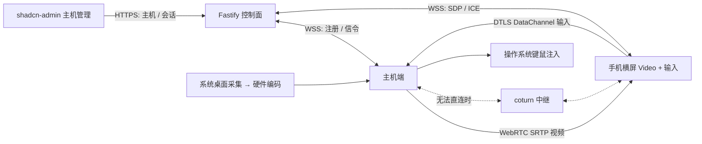

# 架构与扩展

## 核心决策

前端按用户要求克隆 satnaing/shadcn-admin。控制面选 Fastify + TypeScript，与共享协议包一起维护，迭代和接口验证成本低。视频采集/编码/传输独立于 API，换成 Go/Rust API 本身不会改善桌面流畅度。当前实现不依赖 VNC。



图中的系统采集/注入是目标原生实现。当前 `BrowserHost` 用 getDisplayMedia 与浏览器编码器验证 WebRTC，输入仅发送到测试面板。浏览器决定编码器，无法保证使用硬件编码。

## 模块边界

| 层 | 当前实现 | 扩展方向 |
| --- | --- | --- |
| 管理 UI | shadcn-admin 布局、主机列表、鉴权入口 | 主机分组、账户、审计、历史会话 |
| 控制面 | Fastify，单实例内存主机/会话表 | 抽取 HostRepository / SessionRepository，PostgreSQL 元数据、Redis 租约与实例消息 |
| 信令 | WSS 首帧认证，offer/answer/ICE 定向转发 | 版本协商、设备身份、重新协商、ICE restart |
| WebRTC 客户端 | `RemotePeer` 封装协商、双输入通道、统计 | 自适应档位策略、音频、多屏、重连退避 |
| 主机实现 | BrowserHost 测试端 | 原生桌面 Agent（下面的接口和平台选择） |
| 中继 | 可选 coturn REST 短期凭据 | 区域选择、容量与带宽告警、凭据刷新 |

扩展时保持 `Capture → Encoder → WebRTC Sender` 与 `DataChannel → InputSink` 分离。不要把媒体帧或鼠标事件写入 React 全局状态、HTTP 队列或数据库。设备能力应从原生 Agent 注册并由服务端校验；当前服务端明确标记 browser / systemInput=false，不能只修改 UI 标签宣称支持系统控制。

## 原生 Agent 设计（待实现）

原生 Agent 建议采用 **Rust + libwebrtc 绑定**（固定版本并评估构建维护成本），充分利用 WebRTC 的拥塞控制、抖动处理、NACK/PLI 和浏览器互操作性。Rust 自身并不会自动带来硬编或低延迟。应先在目标操作系统完成一个平台端到端基准，再抽象到多平台；不要同时自研 RTP、拥塞控制和编码器。

语言无关接口：

```text
CaptureSource.enumerateDisplays() -> Display[]
CaptureSource.start(display, maxSize, fps) -> GPUFrame(timestamp, texture)
VideoEncoder.encode(GPUFrame, bitrate, requestKeyframe) -> EncodedFrame
VideoTransport.send(EncodedFrame) / requestKeyframe / updateBitrate
InputSink.apply(normalizedInput) / releaseAll()
HostRuntime.startSession(lease, capabilities) / stopSession(reason)
```

| 系统 | 采集 | 编码 | 输入与权限 |
| --- | --- | --- | --- |
| Windows | Windows Graphics Capture；兼容场景用 DXGI Desktop Duplication | NVENC / Quick Sync / AMF 或 Media Foundation；GPU 纹理尽量直入编码器 | SendInput；处理 DPI、虚拟桌面、多屏坐标；UAC 安全桌面不能简单承诺控制 |
| Linux | Wayland 优先 PipeWire + portal；X11 单独适配 | VAAPI / NVENC，处理 DMA-BUF 导入 | portal RemoteDesktop / libei，或受限 uinput；权限与桌面协议相关 |
| macOS | ScreenCaptureKit | VideoToolbox | CGEvent；屏幕录制与辅助功能授权 |

输入通道必须限制类型/长度/速率，绑定会话租约，在断线、失焦、会话切换和超时后释放所有按键。原生设备用单独设备证书/令牌注册；不要向每台主机下发控制端全局密钥。有人值守模式应要求本机确认；无人值守模式需明确授权、设备吊销和审计。

## 性能策略

- 视频采用浏览器原生 `<video>`，不使用 Canvas 逐帧 JPEG 或 React 帧状态。管理页与媒体页分离。
- 默认流畅档目标上限 720p60 / 4 Mbps；均衡 1080p30 / 5 Mbps；清晰 1080p60 / 10 Mbps。上限不保证实际输出，受采集、编码器、网络和手机解码能力约束。
- 编码低延迟模式：关闭 B 帧/深 lookahead，浅队列、过期帧丢弃，优先帧时效。避免 GPU→CPU→GPU 多次复制。码率按 WebRTC 带宽反馈调整，不维持无界缓冲。
- `motion` 通道 unordered / maxRetransmits=0；rAF 合并移动事件，积压超过 4 KiB 丢弃旧移动。按钮事件包含最终坐标，避免与移动通道乱序导致误点。
- `input` 通道 reliable / ordered，用于按键和按钮状态。积压超过 64 KiB 时终止连接，接收端必须 releaseAll，不能丢掉 keyup 然后继续会话。
- 视频编码与输入处理分线程，输入不等待屏幕帧；界面统计每秒更新，测试面板每 200ms 更新。
- WebRTC 已有媒体拥塞控制；当前实现的是静态档位上限，未实现根据设备温度/丢帧自动切档。未来增加滞回和冷却时间，避免频繁振荡。

## 验收计划

以下是需要在真机测量的目标，不是当前已测成绩。建议以手机横屏连续 10 分钟工作负载测试（滚动网页、拖窗、输入），同时记录 PC GPU、手机温升和网络条件。

| 指标 | 初始验收目标 / 方法 |
| --- | --- |
| 局域网操作到显示延迟 | p95 < 100ms；高速摄影或双端时间戳校准，不能拿 getStats RTT 替代 |
| 720p60 稳定性 | 活动画面下实际解码帧率接近目标、无持续积压；记录 frame drop / freeze |
| 编码耗时 | 目标 p95 < 10ms，按 GPU 与分辨率分别验证 |
| 弱网 | 100ms RTT、1–3% 丢包、带宽阶跃，观察降码率及恢复，不积压旧操作 |
| 连接 | 同 LAN / VPN / NAT / TURN TCP-TLS 分别验证成功率与时间 |
| 生命周期 | 断网、锁屏、后台、主机退出后释放按键；退出重连不泄漏媒体轨道 |

优先 P2P，其次同区 TURN。TURN 不转码，但会增加带宽成本与路径延迟。国内或企业网络可能限制 UDP，应提供 TURN/TCP 或 TLS 443 回退并实际测试。Guacamole/VNC 的卡顿还可能来自网络、采集或软件编码，应通过以上指标确认瓶颈。

## 阶段划分

1. **当前基础版本**：管理端、鉴权与信令、浏览器视频链路、输入协议、移动界面、统计与自动测试。
2. **原生平台 MVP**：确认目标 OS，完成采集→硬编→WebRTC→系统输入；多显示器/DPI、权限、失焦释放；进行真机性能验收。
3. **稳定性**：ICE restart、断网重连、动态码率/分辨率、后台恢复、触控板模式、长按和双指手势、音频。
4. **多人/部署扩展**：设备配对与证书轮换、账户与资源授权、PostgreSQL 审计、Redis 会话租约、分区域 TURN。一个会话固定归属一个信令实例，跨实例消息带 sessionId/epoch，避免双重控制。

不默认引入 SFU：当前一对一控制直接 WebRTC 最简单。多人观看、录制或广播确有需求时再增加媒体服务与独立授权。
